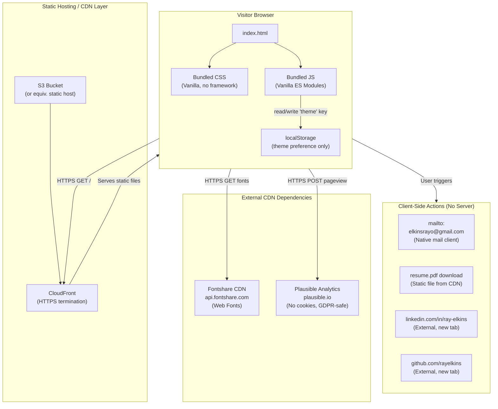
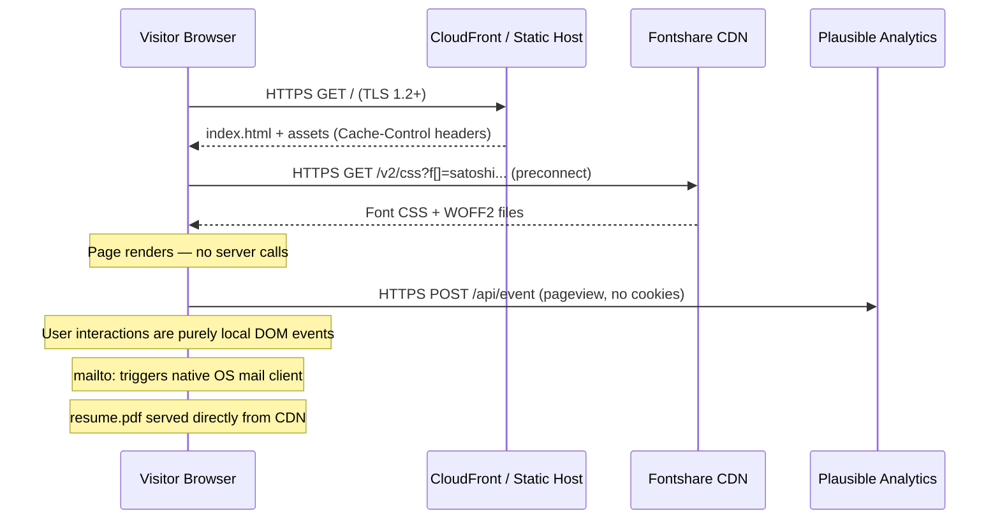

# Design & Architecture Review Document
**Project:** rayelkins.com — Personal Portfolio Site  
**Version:** 1.5 (Current As-Built)  
**Owner:** Ray Elkins  
**Prepared for:** AWS Security Agent — Design Review  
**Review Date:** 2026-06-13  
**Purpose:** Evaluate the site design against security requirements and best practices prior to production deployment.

---

## 1. Executive Summary

`rayelkins.com` is a **static personal portfolio website** built as a single-page application (SPA). It is a purely presentational, client-side site with no backend services, no database, no server-side code execution, and no user authentication. Its primary function is personal brand communication targeting hiring decision-makers in the cloud and AI product space.

**Threat Surface Classification:** Low. No PII is collected or stored. No user-generated input is accepted. No API integrations exist. The entire runtime is confined to the visitor's browser.

---

## 2. Technology Stack

### 2.1 Runtime Technologies

| Layer | Technology | Version | Notes |
|---|---|---|---|
| Markup | HTML5 | Living Standard | Single `index.html` entry point |
| Styling | Vanilla CSS | (Native) | CSS custom properties (design tokens), no preprocessor |
| Scripting | Vanilla JavaScript (ES Modules) | ES2020+ | No framework; direct DOM API |
| Fonts | Fontshare CDN | v2 API | Satoshi (display) + General Sans (body) |

### 2.2 Build Tooling

| Tool | Version | Purpose |
|---|---|---|
| **Vite** | `^5.2.0` | Asset bundler, dev server, production build |
| **Node.js** | `>=18` (implied by Vite 5.x) | Local build environment only — not deployed |
| **npm** | `>=9` | Package manager for build dependencies only |

> **Security Note:** Node.js and npm are **development-only** dependencies. They are not present in the production deployment artifact. The deployed output is a directory of static files (`dist/`).

### 2.3 Third-Party Runtime Dependencies

| Dependency | Type | Domain | Purpose | Data Sent |
|---|---|---|---|---|
| Fontshare | External CDN | `api.fontshare.com` | Web font delivery | Visitor IP (standard HTTP request) |
| Plausible Analytics *(planned)* | External CDN | `plausible.io` | Privacy-respecting analytics | Page URL, referrer, UA string — no cookies |

> **No npm runtime dependencies.** `package.json` lists only `vite` under `devDependencies`. The shipped JavaScript bundle contains zero third-party libraries.

### 2.4 Production Artifact Structure (`dist/`)

```
dist/
├── index.html          # Bundled single-page entry (47 KB source)
├── assets/             # Vite-hashed CSS + JS bundles
│   ├── index-[hash].css
│   └── index-[hash].js
├── headshot.png        # Static image (337 KB)
├── og-image.png        # Open Graph social image (70 KB)
├── resume.pdf          # Downloadable resume (236 KB)
├── robots.txt          # Crawler directives
└── sitemap.xml         # SEO sitemap
```

---

## 3. Architecture Overview

### 3.1 Deployment Model

The site is a **fully static site** intended for deployment to a static hosting provider (e.g., AWS S3 + CloudFront, Netlify, GitHub Pages). There is no:

- Application server (no Node.js, Python, PHP, etc. in production)
- Database or data store
- Server-side rendering (SSR)
- Backend API
- Serverless functions (no Lambda, no Edge Functions)
- CI/CD pipeline (manual `vite build` → upload)

### 3.2 System Architecture Diagram



### 3.3 Data Flow Summary



---

## 4. Security Architecture Decisions

### 4.1 Content Security Policy (CSP) — **Open Item**

> **Current State:** No CSP header is configured.  
> **Risk:** Medium — XSS mitigation is absent. However, with no user-generated content and no inline script injection vectors, the practical risk is limited.  
> **Recommendation:** Implement CSP at the CDN/hosting layer (CloudFront response headers policy):

```
Content-Security-Policy:
  default-src 'self';
  script-src 'self' 'unsafe-inline';
  style-src 'self' 'unsafe-inline' https://api.fontshare.com;
  font-src 'self' https://api.fontshare.com;
  img-src 'self' data: https:;
  connect-src 'self' https://plausible.io;
  frame-ancestors 'none';
  base-uri 'self';
  form-action 'none';
```

> **Note on `unsafe-inline`:** The FOUC-prevention script (dark mode initializer) is an inline `<script>` in `<head>`. This requires `script-src: 'unsafe-inline'` or a nonce-based approach. Given the script is read-only (reads localStorage, adds a class to `<html>`), the risk is negligible in this static, no-input context.

### 4.2 HTTPS / TLS

- **Status:** Enforced at the hosting/CDN layer.
- The site `canonical` URL is `https://rayelkins.com/`. All links use HTTPS.
- `og:image:secure_url` is explicitly set alongside `og:image`.
- Fontshare is loaded via HTTPS with `rel="preconnect"` + `crossorigin` attribute.
- **Recommendation:** Configure HTTP → HTTPS redirect and HSTS (`Strict-Transport-Security: max-age=31536000; includeSubDomains`) at the CDN layer.

### 4.3 External Link Security

All external links (`<a>` tags to LinkedIn, GitHub, and the GitHub `aws-samples` repositories) include:

```html
target="_blank" rel="noopener noreferrer"
```

This prevents:
- **Tabnapping** (`noopener` — new page cannot access `window.opener`)
- **Referrer leakage** (`noreferrer` — suppresses the `Referer` header)

### 4.4 Client-Side Storage

| Storage Mechanism | Key | Value | Purpose | Sensitive? |
|---|---|---|---|---|
| `localStorage` | `theme` | `"dark"` or `"light"` | Persist UI preference across sessions | No |

No cookies are set. No `sessionStorage` is used. No IndexedDB. No service workers.

### 4.5 Email Contact — `mailto:` Pattern

All contact CTAs use a `mailto:elkinsrayo@gmail.com` URI. This:
- Delegates email composition entirely to the visitor's native OS mail client.
- Eliminates any server-side contact form, SMTP relay, or form submission attack surface.
- The address is visible in the HTML source (expected for a personal brand site; not a security risk).

**There is no contact form, no POST endpoint, and no server that processes user input.**

### 4.6 PDF Resume — Static Asset

The resume PDF (`resume.pdf`) is served as a static file directly from the CDN. It:
- Is not dynamically generated.
- Requires no authentication.
- Is intentionally publicly accessible (the purpose is inbound opportunity generation).

### 4.7 Subresource Integrity (SRI) — **Open Item**

> **Current State:** The Fontshare `<link>` tag does not include an `integrity` attribute.  
> **Risk:** Low — Fontshare does not support SRI because their CSS response includes dynamic WOFF2 URLs. This is a known limitation of third-party font CDNs.  
> **Mitigation Options:** Self-host the WOFF2 font files to eliminate this dependency entirely and enable SRI on all local assets.

### 4.8 JSON-LD Structured Data

The `<script type="application/ld+json">` block in `<head>` is a static, hardcoded JSON object. It does not accept any user input and cannot be mutated at runtime. No injection risk.

### 4.9 Dark Mode FOUC Prevention Script

An inline `<script>` block in `<head>` reads `localStorage.getItem('theme')` and conditionally adds the `dark` class to `<html>`. This script:
- Executes before the DOM is painted.
- Performs no network requests.
- Has no user-controlled input paths (reads a fixed localStorage key).
- Cannot be used as an XSS vector in the current architecture.

### 4.10 No Input Attack Surface

The following attack classes are **not applicable** to this site because there are no corresponding features:

| Attack Class | Applicable? | Reason |
|---|---|---|
| SQL Injection | ❌ No | No database |
| Command Injection | ❌ No | No server-side execution |
| CSRF | ❌ No | No authenticated sessions, no state-changing requests |
| Authentication Bypass | ❌ No | No authentication |
| SSRF | ❌ No | No server making outbound requests |
| XXE | ❌ No | No XML processing |
| Path Traversal | ❌ No | Static file serving only |
| Stored XSS | ❌ No | No user-generated content |
| Reflected XSS | ⚠️ Low | No query string rendering, but no CSP yet |

---

## 5. Privacy & Compliance

### 5.1 Data Collection

| Data Type | Collected? | Stored? | Mechanism |
|---|---|---|---|
| PII (name, email, address) | ❌ No | ❌ No | No forms |
| Authentication credentials | ❌ No | ❌ No | No auth |
| Behavioral analytics | ⚠️ Planned | Via Plausible only | Cookieless, GDPR-safe |
| Cookies | ❌ No | ❌ No | None set |
| IP Address (server logs) | ✅ Yes (passive) | By hosting provider | Standard HTTP logging |

### 5.2 Analytics — Plausible (Planned)

Plausible Analytics is selected specifically because:
- It does not use cookies.
- It does not fingerprint users.
- No GDPR cookie consent banner is required.
- Data is aggregated, not individual-level.
- Data is stored in the EU (Plausible is an EU company).

### 5.3 GDPR / CCPA

No personal data is collected, processed, or stored by the site operator. The site does not require a privacy policy for GDPR/CCPA purposes in its current state. The Plausible integration, when added, remains compliant without consent banners per Plausible's GDPR assessment.

---

## 6. Accessibility (a11y) Design

| Requirement | Implementation |
|---|---|
| WCAG AA contrast — dark mode | `#00d4d4` accent on `#0f1117` bg — passes 3:1+ (large text), 4.5:1+ (body) |
| WCAG AA contrast — light mode | `#008080` accent on `#f7f6f2` bg — validated |
| Screen reader H1 | `<h1 class="sr-only">` visually hidden but present for crawlers and AT |
| `aria-label` | Theme toggle button: `aria-label="Toggle dark mode"` |
| `aria-expanded` | Mobile menu toggle reflects open state dynamically |
| Touch targets | Mobile nav links: 44px min height |
| `scroll-padding-top` | Set to `60px` (nav height) to prevent anchor jump occlusion |
| `alt` text | Headshot `` includes a descriptive alt attribute |
| Semantic HTML | `<nav>`, `<main>`, `<section>`, `<h1>`–`<h4>`, `<ul>`, `<li>` used correctly |

---

## 7. SEO & Metadata

| Tag | Value |
|---|---|
| `<title>` | `Ray Elkins — AWS Solutions Architect & Technical Product Manager` |
| `meta description` | 25-year career summary with key metrics |
| `canonical` | `https://rayelkins.com/` |
| `robots` | `index, follow` |
| Open Graph | Full set: title, description, image (1200×630), type, URL |
| Twitter Card | `summary_large_image` |
| JSON-LD | `Person` schema — name, jobTitle, worksFor, sameAs, alumniOf, address |
| `sitemap.xml` | Single URL, monthly changefreq, priority 1.0 |
| `robots.txt` | `Allow: *`, sitemap reference |

---

## 8. Performance Architecture

### 8.1 Asset Loading Strategy

| Asset | Strategy |
|---|---|
| Fonts | `rel="preconnect"` to `api.fontshare.com` with `crossorigin`; `display=swap` |
| Headshot image | Explicit `width="160" height="160"` to prevent CLS |
| CSS | Bundled by Vite into a single hashed file |
| JavaScript | Bundled by Vite; deferred implicitly by module type |

### 8.2 Build Configuration

`vite.config.js` sets `base: './'` so all asset paths are **relative**, not root-absolute. This allows the `dist/` directory to be opened directly from the filesystem without a web server — useful for local preview and ZIP distribution. In a CDN deployment, the canonical base is `https://rayelkins.com/`.

### 8.3 Caching

Cache behavior is controlled at the hosting/CDN layer (not in the application code). Recommended cache strategy for CDN deployment:

| File | Recommended Cache-Control |
|---|---|
| `index.html` | `no-cache` (ensures fresh HTML on deploy) |
| `assets/*.css`, `assets/*.js` | `public, max-age=31536000, immutable` (Vite hash-named) |
| `*.png`, `*.pdf` | `public, max-age=604800` (1 week) |
| `robots.txt`, `sitemap.xml` | `public, max-age=86400` (1 day) |

---

## 9. CSS Architecture

All styles are authored in **Vanilla CSS** organized across 7 files:

| File | Responsibility |
|---|---|
| `style.css` | Global design tokens (CSS custom properties), reset, nav, buttons, containers |
| `hero.css` | Hero section layout and photo styling |
| `about.css` | About grid, stat cards |
| `experience.css` | Timeline, badges, achievement callout, collapse animation |
| `skills.css` | Skills grid, pill styles |
| `work.css` | Case study cards |
| `extras.css` | Recognition, certifications, contact, footer |

Files are imported via `main.js` ES module imports and bundled by Vite at build time into a single hashed CSS file in `dist/assets/`.

### 9.1 Design Tokens (CSS Custom Properties)

```css
/* Light Mode (default) */
--color-bg: #f7f6f2;
--color-text-main: #1a1a1a;
--color-text-muted: #555555;
--color-surface: #ffffff;
--color-accent: #008080;        /* Teal — single accent color */
--color-surface-alpha: rgba(247, 246, 242, 0.85);  /* Nav blur surface */

/* Dark Mode (html.dark) */
--color-bg: #0f1117;
--color-text-main: #f0f0f0;
--color-text-muted: #a0a0a0;
--color-surface: #1a1d27;
--color-accent: #00d4d4;        /* Brighter teal for dark bg contrast */
--color-surface-alpha: rgba(15, 17, 23, 0.85);
```

---

## 10. JavaScript Architecture

All runtime JavaScript is **Vanilla ES Modules** — no framework, no library, zero npm runtime dependencies.

### 10.1 Module Inventory (`main.js`)

| Function | Behavior | APIs Used |
|---|---|---|
| `setupThemeToggle()` | Reads/writes `dark` class on `<html>`; persists to `localStorage` | `classList`, `localStorage` |
| `setupNavigation()` | Scroll blur on nav; mobile menu toggle; IntersectionObserver for active nav link | `IntersectionObserver`, `classList`, `window.scrollY` |
| `setupExperienceToggle()` | Expand/collapse earlier work history | `classList`, `innerHTML` |
| FOUC guard (inline `<head>`) | Reads localStorage, sets `dark` class before paint | `localStorage`, `matchMedia`, `classList` |

### 10.2 Browser API Usage

| API | Purpose | Risk Classification |
|---|---|---|
| `localStorage` | Theme preference persistence | None — stores only a UI preference string |
| `IntersectionObserver` | Active nav link highlighting | None — read-only DOM observation |
| `window.matchMedia` | Detect system dark mode preference | None — read-only |
| `document.querySelectorAll` | DOM traversal | None — no user input reflected |
| `classList.toggle/add/remove` | UI state management | None |

---

## 11. Open Security Items for Review

| ID | Item | Severity | Status |
|---|---|---|---|
| SEC-01 | Content Security Policy not yet configured | Medium | Open — implement at CDN layer |
| SEC-02 | HSTS header not yet configured | Medium | Open — implement at CDN layer |
| SEC-03 | Fontshare font CDN not SRI-eligible | Low | Accepted risk or self-host fonts |
| SEC-04 | `unsafe-inline` required for FOUC script | Low | Accepted — or refactor to nonce-based CSP |
| SEC-05 | Plausible analytics not yet integrated | Info | Planned — use official Plausible script tag |
| SEC-06 | No clickjacking protection (`X-Frame-Options`) | Low | Open — set `DENY` at CDN layer |
| SEC-07 | No `Permissions-Policy` header | Info | Open — restrict camera, microphone, geolocation |

### Recommended Security Headers (CDN Layer)

```
Strict-Transport-Security: max-age=31536000; includeSubDomains; preload
X-Content-Type-Options: nosniff
X-Frame-Options: DENY
Referrer-Policy: strict-origin-when-cross-origin
Permissions-Policy: camera=(), microphone=(), geolocation=()
Content-Security-Policy: [see Section 4.1]
```

---

## 12. Decisions Log

| Decision | Rationale |
|---|---|
| **No backend / purely static** | Eliminates the entire server-side attack surface. No user data to protect. Infinitely scalable via CDN. |
| **Vanilla JS — no React/Vue/Angular** | Single-page portfolio has minimal interactivity. Framework overhead (bundle size, supply-chain risk) is unwarranted. |
| **Vanilla CSS — no Tailwind/Bootstrap** | Full control over design tokens. No third-party CSS class injection risk. Smaller footprint. |
| **Vite as bundler** | Industry-standard, actively maintained. Zero runtime presence in production. Hash-based filenames enable long-term CDN caching. |
| **`mailto:` for contact, no form** | Eliminates form spam, CSRF, and server-side mail processing entirely. User's native mail client handles composition and sending. |
| **localStorage for theme only** | No cookies needed. No GDPR consent trigger. Minimal scope. |
| **Fontshare for typography** | Premium fonts (Satoshi, General Sans) not available on Google Fonts. Accepted third-party CDN dependency. |
| **Plausible for analytics** | Privacy-respecting by design. No cookies. No GDPR consent banner required. Aggregated data only. |
| **`rel="noopener noreferrer"` on all external links** | Defense in depth against tabnapping and referrer leakage. |
| **Inline FOUC guard script** | Required to apply dark class before first paint. Risks are contained (read-only localStorage access). |
| **`base: './'` in Vite config** | Supports filesystem-level preview (`file://`) and ZIP distribution without breaking relative asset paths on CDN. |
| **Sitemap + robots.txt** | Enables clean, indexed discoverability. All content is intentionally public. |

---

*Document prepared by Antigravity AI coding assistant — June 2026*  
*For questions about this document, contact: Ray Elkins — elkinsrayo@gmail.com*
